<p align="center">
  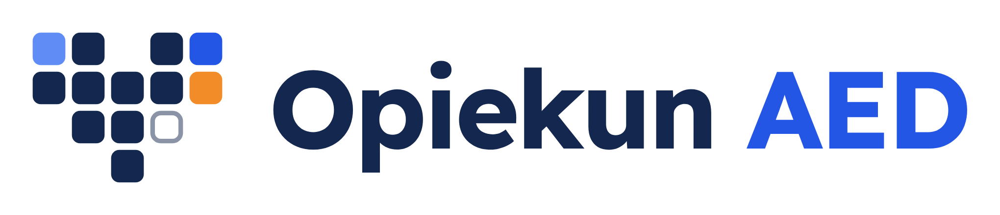
</p>

<p align="center"><b>Dbasz o AED? Pokaż to w danych.</b></p>

<p align="center">
Jeden ogólnopolski, otwarty i aktualny zbiór danych o defibrylatorach AED na dane.gov.pl.<br>
Rozwiązanie zadania „Misja AED – Dane na ratunek” (HackNation 2026, Ministerstwo Cyfryzacji).
</p>

<p align="center">
  <a href="https://aed.heckyeah.pl/pl/aed"><b>Prototyp</b></a> ·
  <a href="https://aed.heckyeah.pl/pl">Portal z forka</a> ·
  <a href="https://aed.heckyeah.pl/prezentacja.html">Prezentacja</a> ·
  <a href="docs/instrukcja-dla-jury.md">Instrukcja dla jury</a> ·
  <a href="wzorzec/wzorzec-aed.xlsx">Wzorzec XLSX</a>
</p>

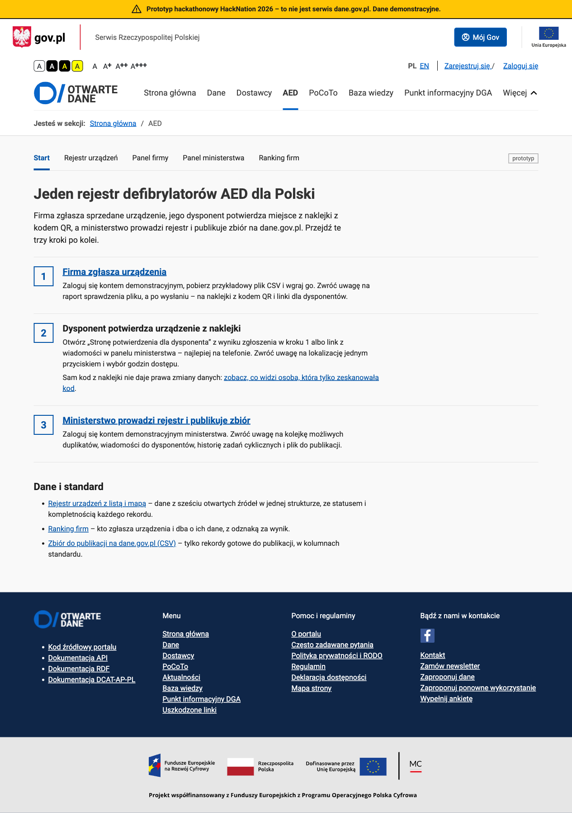

## Sprawdź bez instalacji

| Co | Adres | Konto |
|---|---|---|
| Prototyp: zgłoszenie firmy, naklejka QR, potwierdzenie, rejestr | <https://aed.heckyeah.pl/pl/aed> | konta demo niżej |
| Portal z forka: zbiór zbiorczy, tabela, mapa | <https://aed.heckyeah.pl/pl> | bez logowania |
| Wykaz krajowy do odczytu (API) | <https://aed-api.heckyeah.pl/aed-aggregated> | bez logowania |
| Panel administracyjny portalu | <https://aed-admin.heckyeah.pl/> | `jury@aed.example` / `jury-demo-2026` |
| Prezentacja | [HTML](https://aed.heckyeah.pl/prezentacja.html) · [PDF](https://aed.heckyeah.pl/prezentacja.pdf) | – |

Konta demo w prototypie (hasła są jawne celowo, na czas pokazu):

| Rola | E-mail | Hasło |
|---|---|---|
| sprzedawca | `serwis@aed.example` | `serwis-demo` |
| producent | `pulsar@aed.example` | `pulsar-demo` |
| ministerstwo | `ministerstwo@aed.example` | `ministerstwo-demo` |

Ścieżki krok po kroku i tabela „wymaganie → ekran → jak sprawdzić”: [`docs/instrukcja-dla-jury.md`](docs/instrukcja-dla-jury.md).

## Problem

Dane o defibrylatorach w Polsce istnieją, ale są rozproszone i nikt za nie nie odpowiada. Stan z naszego mappera ([`datasets/out/raport.json`](datasets/out/raport.json)):

- **6 źródeł w 6 układach**: cztery zbiory miejskie na dane.gov.pl (razem 74 rekordy), API Warszawy (708) i OpenStreetMap (18 298).
- **18 814 rekordów** po sprowadzeniu do jednego standardu i połączeniu 266 duplikatów.
- **0 rekordów** potwierdzonych przez kogoś, kto odpowiada za urządzenie.
- **781 rekordów** nadaje się dziś do publikacji na dane.gov.pl. Reszta to głównie dane OpenStreetMap na licencji ODbL, których nie mieszamy z danymi otwieranymi przez ministerstwo.

## Jak to działa

Dwa kanały zasilają jeden standard danych ([`aed_standard/schema.json`](aed_standard/schema.json)). Zbiór publikuje ministerstwo.

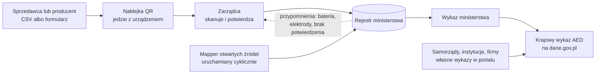

### 1. Firma zgłasza urządzenia przy sprzedaży

Plik CSV albo formularz z konta firmy. Usługa sprawdza każdy wiersz i mówi po polsku, co poprawić. Każde przyjęte urządzenie dostaje identyfikator i naklejkę z kodem QR.

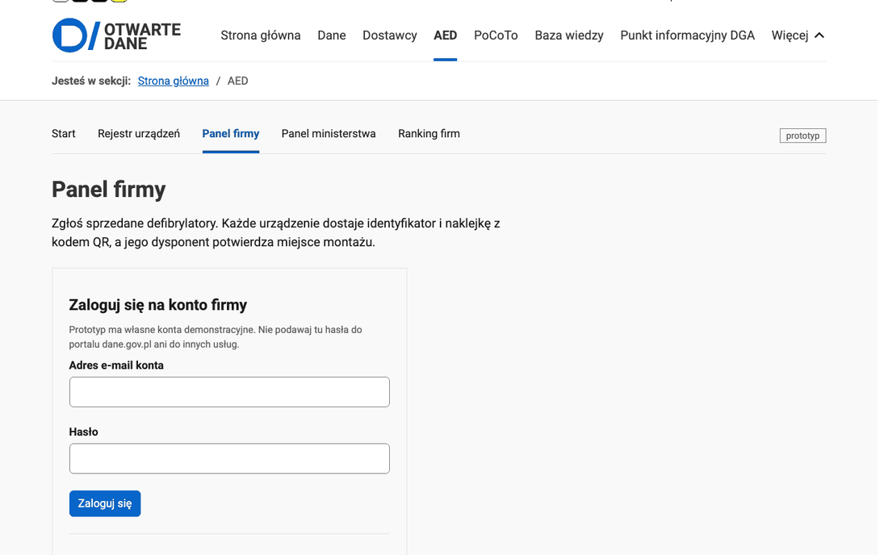

### 2. Zarządca skanuje naklejkę i potwierdza dane

Trzy kroki na telefonie, bez instalowania aplikacji: lokalizacja (z geolokalizacji telefonu), godziny dostępu, stan urządzenia. Rekord dostaje status „Zweryfikowany”. Osoba postronna po zeskanowaniu kodu może tylko zgłosić problem – danych nie zmieni.

<p>
  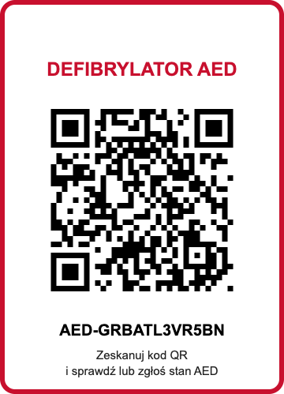
  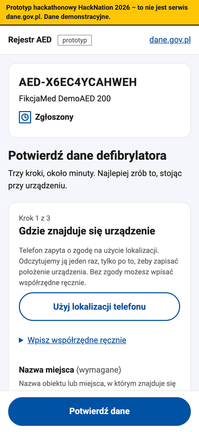
  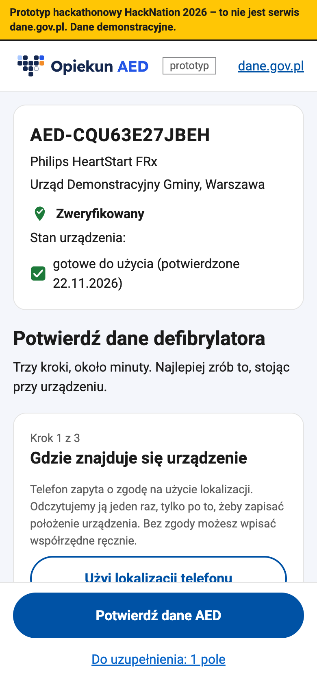
  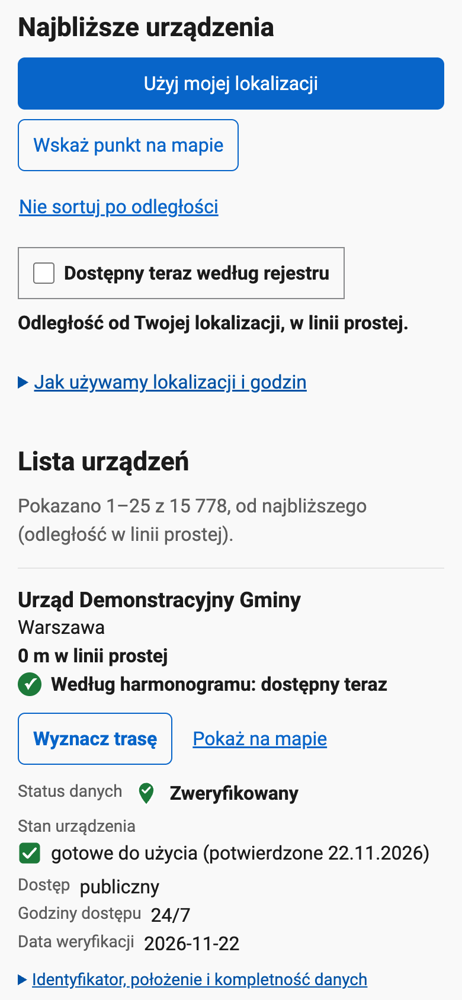
</p>

### 3. Ministerstwo prowadzi rejestr i publikuje zbiór

Panel ministerstwa: stan rejestru, pary możliwych duplikatów do przeglądu, zaproszenie zarządcy do przejęcia punktu z importu, przypomnienia o terminie baterii i elektrod, mapper otwartych źródeł.

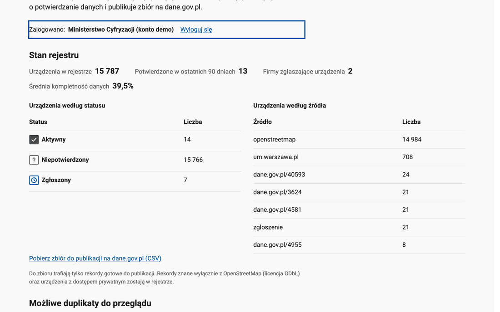

### 4. Portal scala wykazy w jeden Krajowy wykaz AED

To główna ścieżka i odpowiedź na wskazówkę prowadzącego. Dostawca oznacza zasób w swoim zbiorze jako „Wykaz AED”. Portal sprawdza plik przy zapisie, a zadanie dzienne scala wszystkie wykazy, usuwa duplikaty i publikuje zasób zbiorczy w zbiorze ministerstwa – tym samym mechanizmem, którym portal scala już wykazy DGA. Kod: [`backend/mcod/aed/`](backend/mcod/aed/), opis: [`docs/wykaz-aed-w-portalu.md`](docs/wykaz-aed-w-portalu.md).

| Tabela zasobu zbiorczego | Mapa zasobu zbiorczego |
|---|---|
| 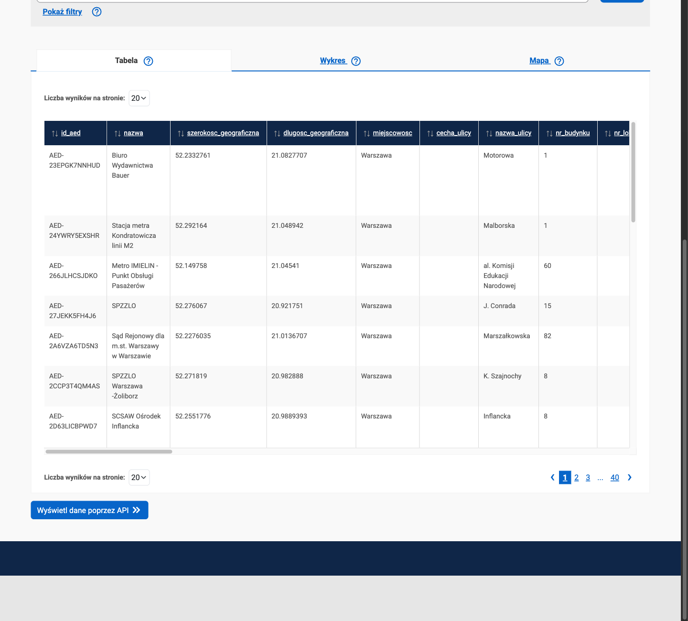 | 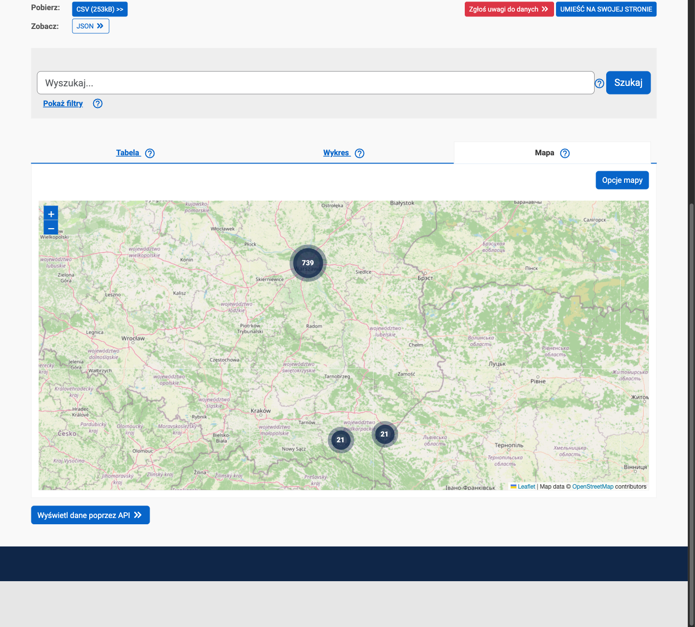 |

Wykaz, który nie spełnia standardu, portal odrzuca i wskazuje, co poprawić:

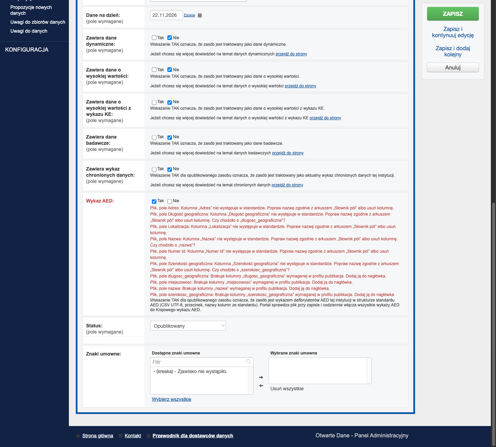

Stan na serwerze (22.11.2026): 3 wykazy, 2 przyjęte (Ministerstwo Cyfryzacji, Legionowo), 1 odrzucony (Krosno); 805 rekordów z wykazów, 781 po deduplikacji.

## Rejestr i mapa

Mapa jest dodatkiem do dostępnej listy. Filtr statusu, wskaźnik kompletności każdego rekordu, „dostępne teraz”, najbliższy AED.

| Mapa kraju | Mapa miasta z legendą statusów |
|---|---|
| 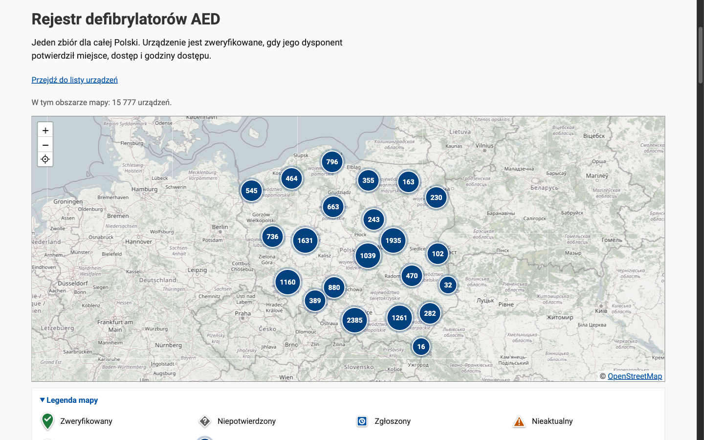 | 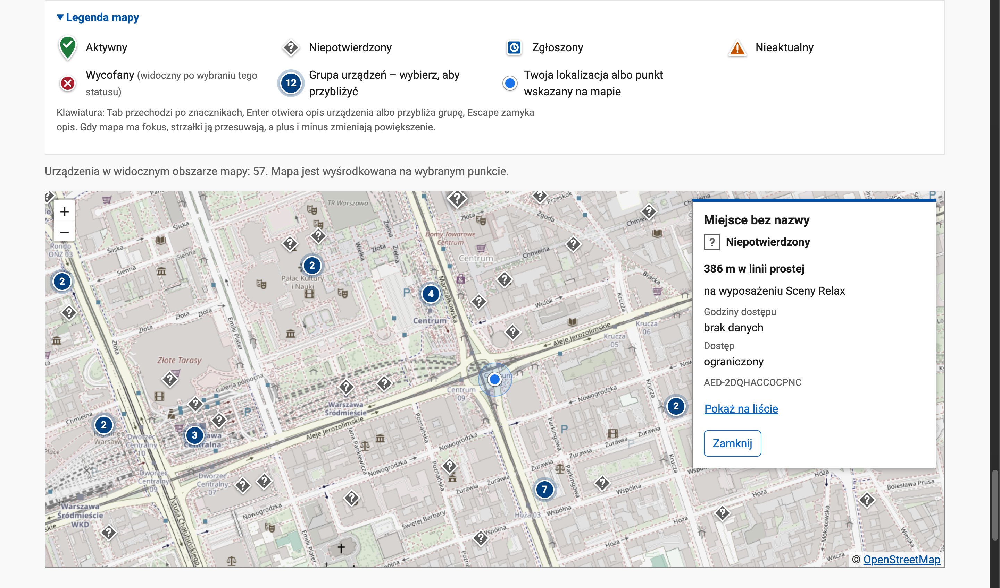 |

## Standard danych

Jeden wiersz to jedno urządzenie. Jedna struktura dla wszystkich źródeł, zgodna z tym, co już leży na dane.gov.pl (plik Legionowa jest jej poprawnym podzbiorem). Ze schematu powstają formularze, walidator, mapper, eksporty i [`wzorzec/wzorzec-aed.xlsx`](wzorzec/wzorzec-aed.xlsx).

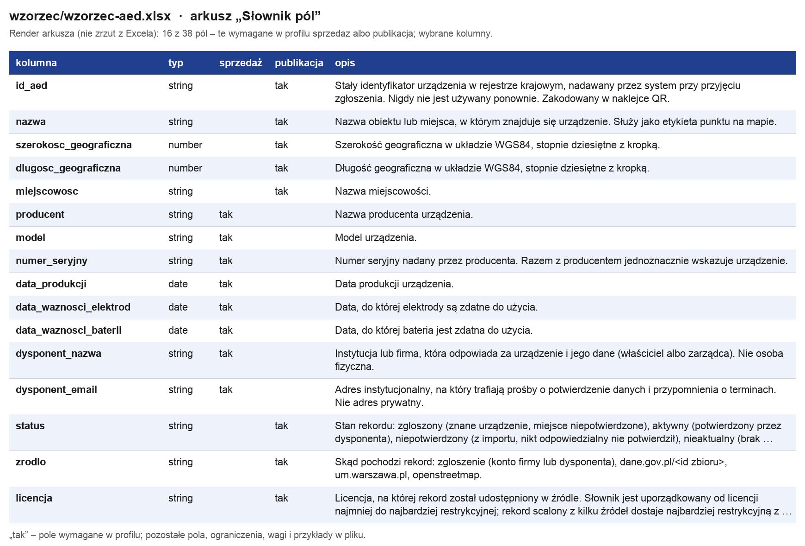

- **Dwa profile wymagalności:** `sprzedaz` (sprzedawca zna urządzenie i nabywcę) oraz `publikacja` (rekord w zbiorze otwartym).
- **Cykl życia rekordu:** zgłoszony → zweryfikowany → nieaktualny → wycofany; rekord z importu, którego nikt nie potwierdził, jest „niepotwierdzony”.
- **Deduplikacja:** ten sam producent i numer seryjny to to samo urządzenie; rekordy z różnych źródeł do 15 m łączymy automatycznie, do 50 m kierujemy do przeglądu; dwóch rekordów z tego samego źródła nie łączymy nigdy.
- **Dane publiczne** nie zawierają numeru seryjnego ani kontaktu do dysponenta.

## Akcja „Opiekun AED”

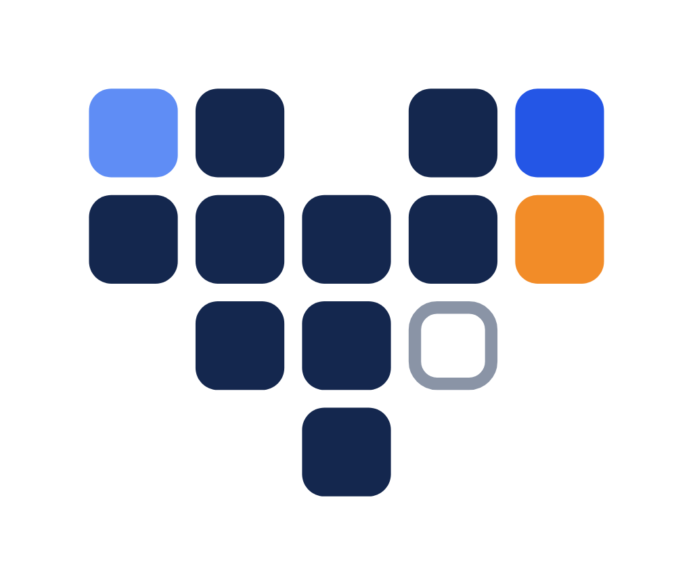

Każda komórka znaku to jedno urządzenie, a kolor mówi, w jakim stanie są jego dane. Firma, która zgłasza urządzenia i utrzymuje aktualne dane, dostaje odznakę, miejsce na mapie sprzedawców i przypomnienia o terminie baterii i elektrod.

- Logo (SVG, PNG, JPG, PDF; kolor, mono, negatyw): [`kampania/logo/`](kampania/logo/)
- Księga znaku: [`kampania/opiekun-aed-ksiega-znaku.pdf`](kampania/opiekun-aed-ksiega-znaku.pdf)
- Zachęty dla firm i samorządów: [`kampania/zachety.md`](kampania/zachety.md)

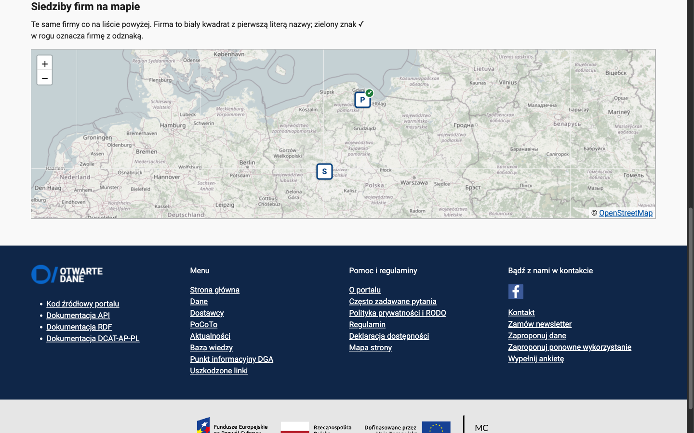

## Dostępność i responsywność

Cel: WCAG 2.2 AA. Obsługa klawiaturą, stan przekazany tekstem i ikoną, tryby kontrastowe portalu, układ działa przy 320 px. Dowody (zrzuty, raporty axe): [`frontend/aed-zrzuty/DOSTEPNOSC.md`](frontend/aed-zrzuty/DOSTEPNOSC.md).

<p>
  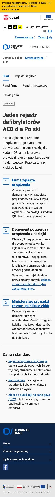
  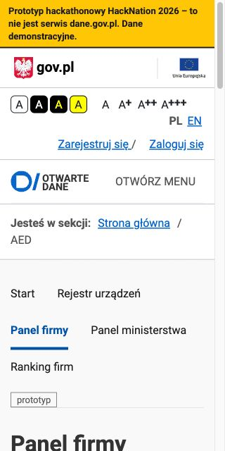
  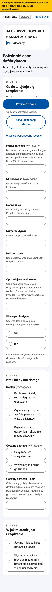
  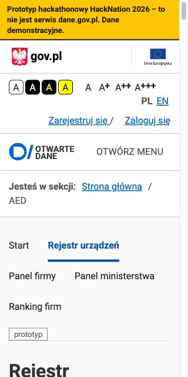
  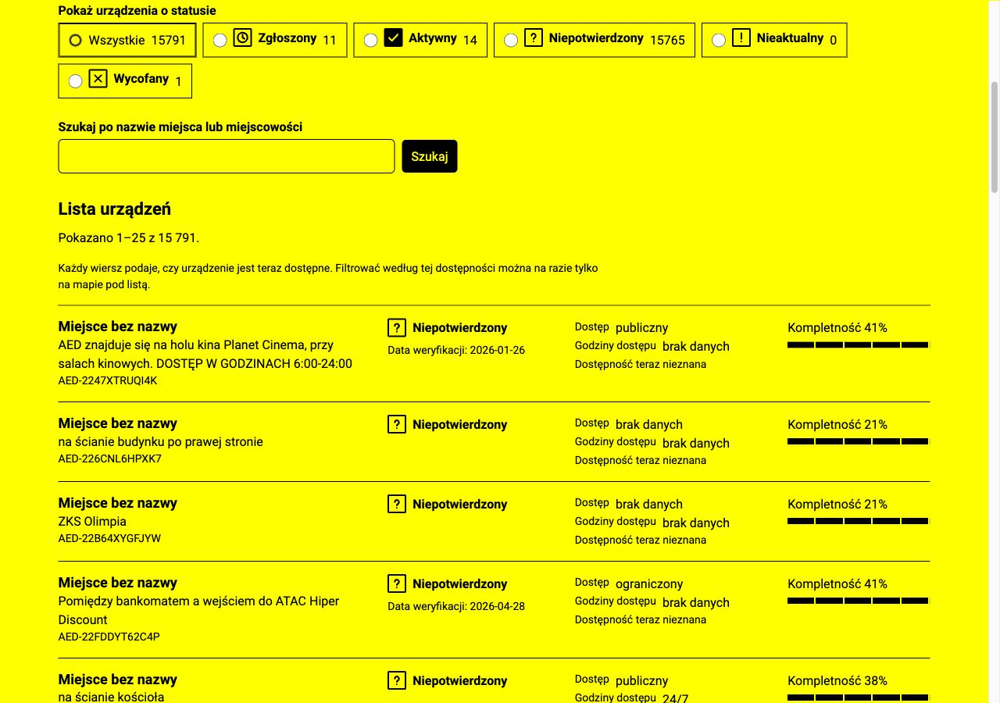
</p>

## Ograniczenia

- To prototyp z danymi demonstracyjnymi, nie serwis dane.gov.pl.
- Wszystkie rekordy z importu mają status „niepotwierdzony” – potwierdza je dopiero zarządca.
- Dane OpenStreetMap (ODbL) zostają w rejestrze i nie trafiają do zbioru na dane.gov.pl; wymaga to opinii prawnika.
- Nie ma dziś podstawy prawnej obowiązku raportowania przez sprzedawców, więc proces opiera się na dobrowolności i zachętach.
- Nie obiecujemy uratowanych istnień. Mierzymy proces: liczbę dostawców, kompletność, udział rekordów potwierdzonych.

Zakres użycia AI: [`docs/uzycie-ai.md`](docs/uzycie-ai.md).

## Uruchomienie jedną komendą

Wymaga Dockera.

```
docker compose up --build
```

Potem otwórz `http://localhost:8080/pl/aed`. Pierwsza budowa trwa kilka minut.

Strony portalu poza obszarem AED pobierają w tym lekkim wariancie dane tylko do odczytu z publicznego API dane.gov.pl. Nie loguj się w nich kontem portalu.

Pełny fork portalu (frontend, API, panel administracyjny, wykaz AED) z usługą AED pod domeną z HTTPS: [`docs/wdrozenie-serwer.md`](docs/wdrozenie-serwer.md) i [`docs/wdrozenie-pve.md`](docs/wdrozenie-pve.md).

## Co jest w repozytorium

| Katalog | Zawartość |
|---|---|
| `aed_standard/` | standard danych (`schema.json`), walidator, mapper źródeł, deduplikacja – czysty Python bez zależności |
| `aed_service/` | usługa API: konta firm, zgłoszenia CSV, naklejki QR, potwierdzenia, rejestr (`docs/api-aed.md`) |
| `frontend/` | fork frontendu dane.gov.pl z modułem AED (`src/app/pages/aed/`) |
| `backend/` | fork backendu dane.gov.pl; zmiany wydzielone w `mcod/aed/` (wykaz AED) plus pole zasobu `contains_aed_list` (model, formularz, migracja); wdrożenie pod domeną: `docker-compose.aed-domain.yml`, `aed-domain/` |
| `wzorzec/` | `wzorzec-aed.xlsx` – wzorcowy zakres danych – oraz przykładowe pliki CSV |
| `datasets/` | surowe źródła (`raw/`) i wynik mappera (`out/`) |
| `prezentacja-html/` | prezentacja dla jury: `prezentacja.html` (jeden plik, otwiera się bez sieci) i `prezentacja.pdf` |
| `video/` | film promocyjny (Remotion); render: `npm ci && npm run render` |
| `kampania/` | akcja „Opiekun AED”: logo w czterech formatach, księga znaku (PDF), hasło, zachęty |
| `docs/` | treść zadania, kontrakt API, instrukcja dla jury, pozostałe dokumenty |

## Praca bez Dockera

```
# zbiór krajowy z surowych źródeł (ok. 2 s)
python3 -m aed_standard build

# walidacja pliku firmy
python3 -m aed_standard validate wzorzec/przyklad-sprzedawca-bledy.csv --profil sprzedaz

# usługa API na porcie 8085
uv run --python 3.13 --with-requirements aed_service/requirements.txt python -m aed_service

# frontend na porcie 4200
cd frontend && npm ci && npm run start:aed

# frontend z lokalnym backendem portalu (mcod: API :8000, CMS :8002, nginx :443) zamiast publicznego API;
# porty publikuje backend/docker-compose.aed-ports.yml
cd backend && docker compose -f docker-compose.local.yml -f docker-compose.aed-ports.yml up mcod-local-api mcod-local-admin mcod-local-cms mcod-local-celery
cd frontend && npm run start:aed-local

# testy
uv run --python 3.13 --with-requirements aed_service/requirements.txt python -m unittest
```

Plan pracy, zasady i podział zadań: `CLAUDE.md`.
